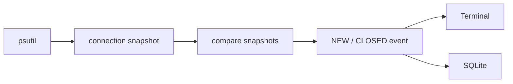

# NetSent

a network connection monitor with an anomaly detector written in python.
currently a pet project built for educational purposes

## current features

- monitors system network connections using psutil
- maps connections to processes
- detects NEW and CLOSED connections
- stores events in SQLite
- groups events into 10s windows per process and extracts behavioural features
- scores windows with an autoencoder written in plain numpy
- explains alerts by the features with the largest reconstruction error
- benchmarks the autoencoder against isolation forest



## how detection works


features per window and process:

| feature | meaning |
|---|---|
| new_conns | new connections with a remote address |
| closed_conns | closed connections with a remote address |
| uniq_rports | distinct remote ports |
| uniq_rips | distinct remote hosts |
| fail_ratio | share of closed connections that never left SYN_SENT |
| new_ip_ratio | share of remote hosts this machine has never talked to |
| new_listen | new listening sockets |
| udp_ratio | share of new sockets that are UDP |

counts go through log1p, then z-score. the autoencoder is 8-6-3-6-8 with tanh and adam ([autoencoder.py](autoencoder.py)).
the threshold is the 99.5th percentile of scores on the training traffic, so it sets the false alarm budget.
an alert names the features that carry most of the reconstruction error, for example
`82% of closed connections were never established (expected ~5%); 90 distinct remote hosts (expected ~4)`

## usage

```
sudo .venv/bin/python3 main.py
> watch     # collect normal traffic for a few hours (events land in netsent.db)
> train     # fit the model on everything logged, saves model.npz
> detect    # score live traffic and print explained alerts
```

## evaluation

`python evaluate.py` simulates normal desktop traffic, injects attacks into the test period
and compares the autoencoder with sklearn's IsolationForest (same features, same threshold rule).
`python evaluate.py --db netsent.db` uses your own logged traffic as the normal part instead.

synthetic run (seed 0, 8h, 48 injected attacks):

| model | precision | recall | f1 | roc auc | false alarms / hour |
|---|---|---|---|---|---|
| autoencoder | 0.94 | 0.55 | 0.69 | 0.87 | 3.3 |
| isolation forest | 0.97 | 0.44 | 0.60 | 0.87 | 1.2 |

| attack | autoencoder recall | isolation forest recall |
|---|---|---|
| port scan | 1.00 | 1.00 |
| slow scan | 0.90 | 0.74 |
| host sweep | 0.86 | 0.89 |
| brute force | 0.69 | 0.19 |
| beacon | 0.00 | 0.00 |
| backdoor listener | 0.38 | 0.29 |

the autoencoder catches more, but it also raises roughly 2-3x more false alarms.
beaconing, meaning one quiet connection to a new host every 15s, is invisible to both models with these features.

## limitations

- the data is polled snapshots from psutil (2s in watch, 1s in detect), so connections that live shorter than the poll interval are missed
- `nmap -sS` uses raw sockets and never shows up in psutil. only `nmap -sT` (connect scan) from this machine is visible
- inbound scans against closed ports create no sockets at all, so detecting them needs packet capture
- psutil has no per-connection byte counters, so traffic volume is not a feature yet
- synthetic numbers only show that the pipeline works. real numbers need public datasets (CIC-IDS2017, UNSW-NB15) and live tests in a VM

## roadmap

- [x] features + windowing
- [x] numpy autoencoder + isolation forest baseline
- [x] explanations
- [ ] benchmark on CIC-IDS2017 / UNSW-NB15
- [ ] live nmap -sT tests against a VM
- [ ] tray icon or local web page with a score feed
- [ ] shodan internetdb enrichment of remote hosts
