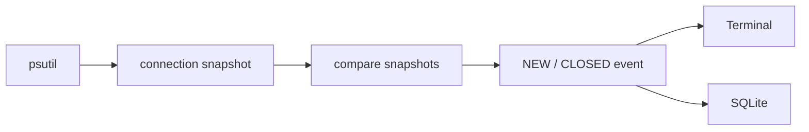

# NetSent

a linux network connection monitor written in python.
currently a pet project built for educational purposes

## current features

- monitors system network connections using psutil
- maps connections to processes
- detects NEW and CLOSED connections
- stores events in SQLite

